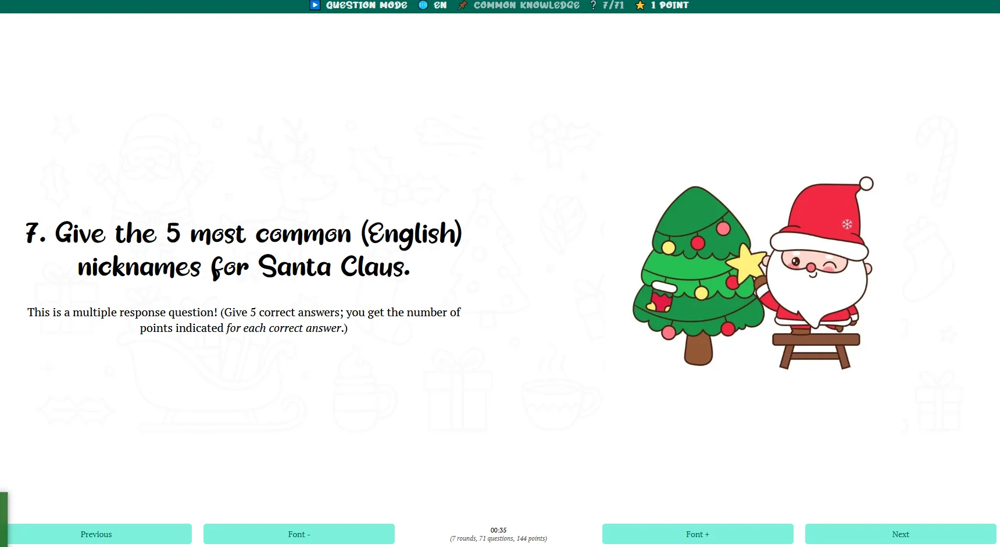

# PQ Trivia

An easy system to generate digital or analog (pub) quiz experiences. 

* Write your questions in simple text (or Markdown) files.
* Gather all the media for your quiz (image/audio/video) as separate files too.
* Then create an empty HTML page, include this library, and create a new `Quiz` with your preferred settings.

Tada! All your work is transformed into an interactive trivia experience. You can even let every player bring their own 5 questions, because you never need to see inside the text files.

Read the [docs](https://github.com/Pandaqi/pq-trivia/blob/main/docs.md) for a more detailed explanation. This includes the very simple "syntax" for inputting questions (answers, score, media to include, etc), as well as the _many_ settings you can change and modify to your liking.

## Quick Start

Check out the barebones `template` folder for the simplest setup for a new quiz.

* A very simple `index.html` file that includes the library and starts a new Quiz.
* The library (`pq-trivia.min.js`) itself, of course. (Replace with latest version if needed.)
* Add your questions in the `questions` folder.
* Add all your media in the `media` folder.
* Open `index.html` in any browser, point it to your questions, and you're good to go.

## Features

This powerful (pub) quiz system was designed to support my own quizzes. I've created many (_many_) professional quizzes and sell them at [The Wayward Melody](https://thewaywardmelody.com). As such, the system is maintained regularly as I create new quizzes for that online store and want new features (or find mistakes).

The system currently supports,

* Playing the quiz completely digitally or physically (print as PDF)
* Printing tailored answer forms and answer sheets.
* Different question types (open, multiple choice, list, sort, numeric range, etc)
* Splitting questions into rounds, as well as some simple round properties (such as a "secret theme")
* Powerful tools for randomly sorting and ordering your questions and rounds.
* Media (image/audio/video) attached to questions or answers.
* Powerful custom theming (fonts, colors, background, etcetera)
* Translations / multiple languages
* Playing interactively by inputting answers on the screen itself (which also allows automatic grading)
* Exporting / saving the quiz as a JSON object
* Custom question properties, such as score, hints, author, category, a timer, etcetera
* Playing from the embedded JSON data, or from local files (offline), or from files hosted on a server (online).
* ... and much more.